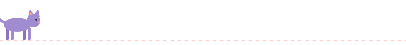

# Привет, я Ксения

## 📚 Чем занимаюсь сейчас

Учусь и пробую всё на практике: читаю теорию, а потом сразу пишу код.

Сейчас я разбираюсь сразу в нескольких направлениях:
- ⚙️ **C++** 
- 🎨 **HTML + CSS**
- 🐍 **Python**
- 🔀 **Git**
## 🛠 Технологии

